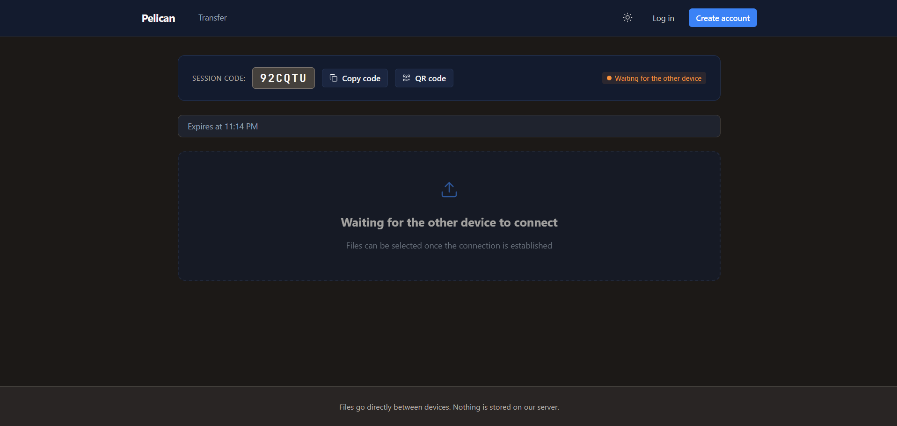
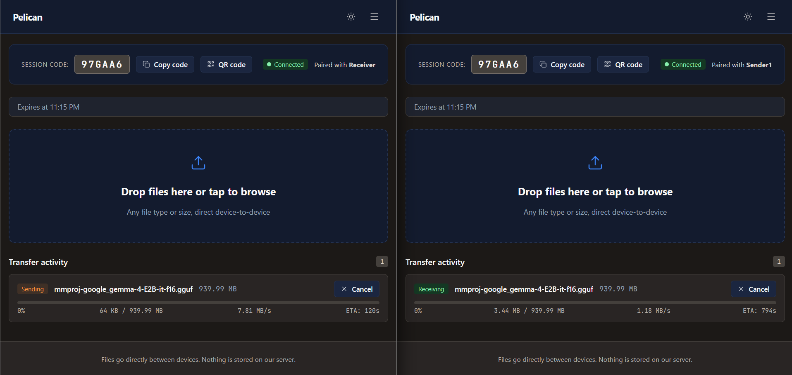
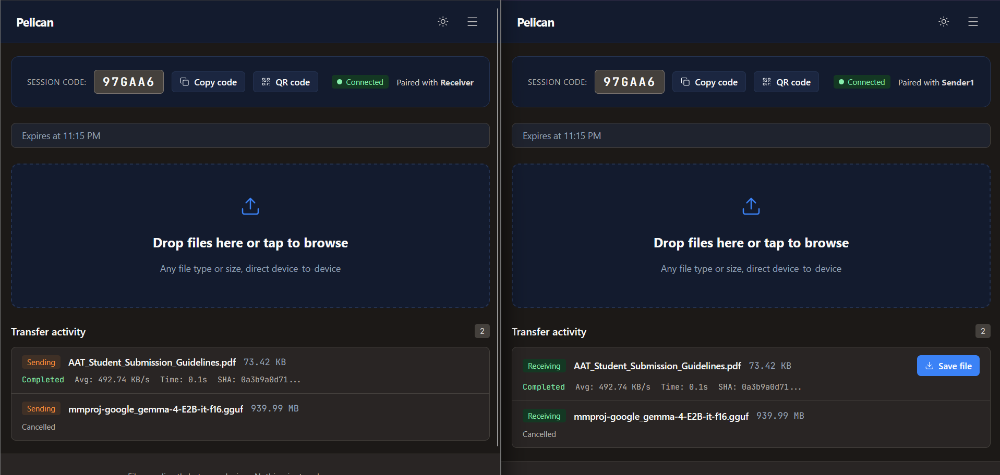
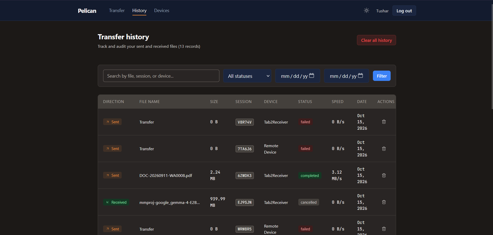
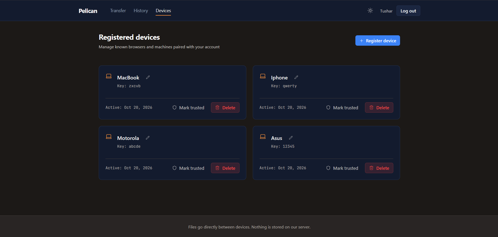
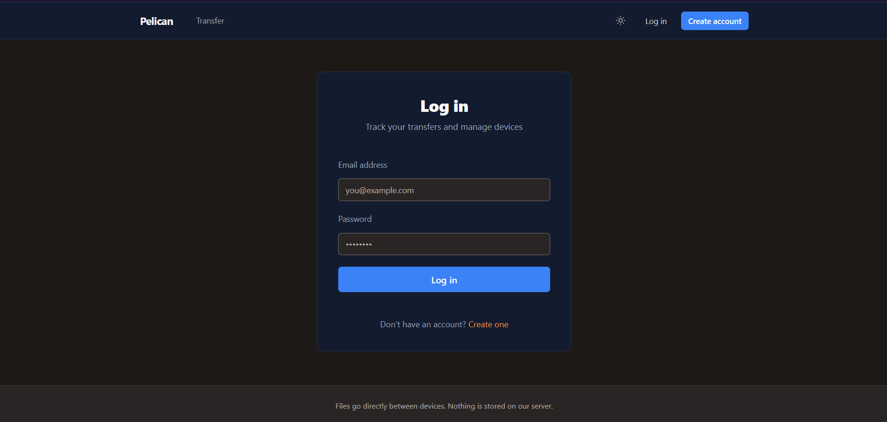
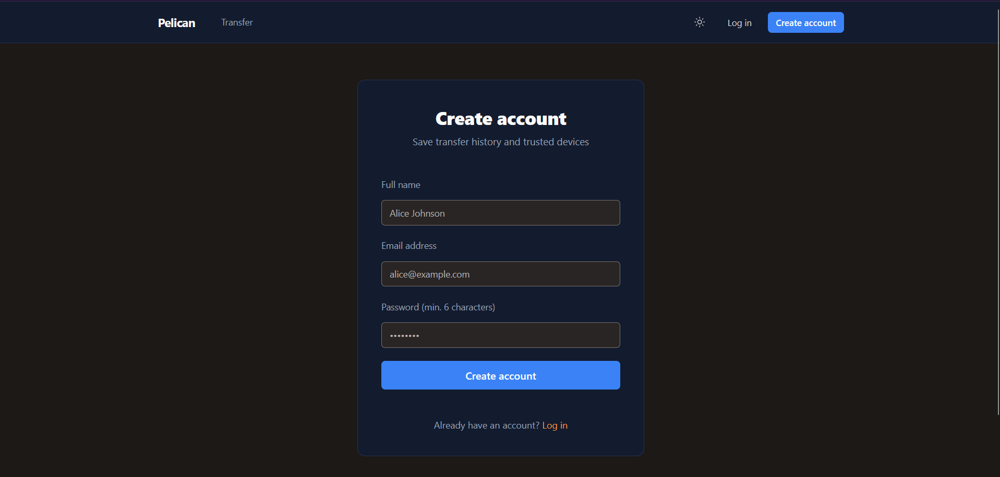
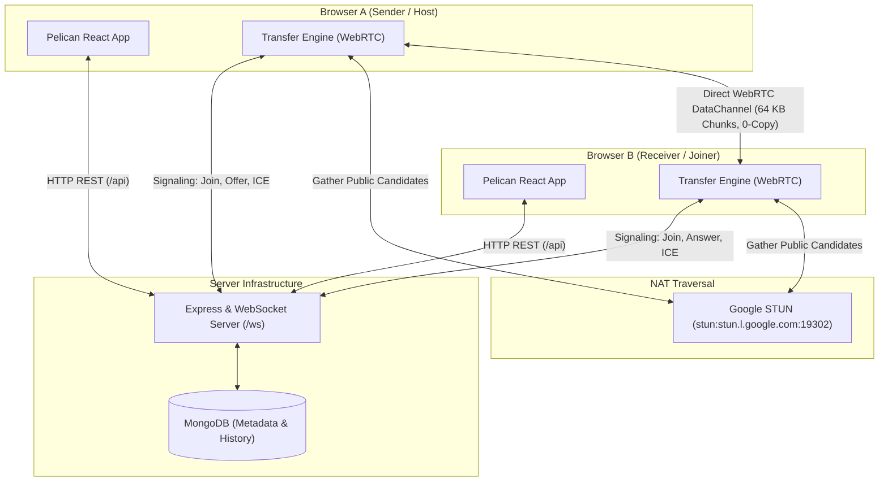

# Pelican

Peer-to-peer file transfer directly between browsers using WebRTC data channels.

Pelican provides a private, fast, and simple way to send files between devices over local Wi-Fi or the internet. File payloads are streamed directly between browser data channels; file data is never sent to, routed through, or stored on any server.

---

## Screenshots

Visual documentation of the key workflows across Pelican:

### Pairing Screen
6-character room code, QR code modal, and connection status.


### Active File Transfer
Live progress bar with real-time transfer rate, byte metrics, and ETA.


### Completed Transfer
Verified completion summary with duration, average throughput, and SHA-256 hash.


### Transfer History
Audit table of sent and received transfers with search and status filters.


### Trusted Devices
Known browsers and machines paired with account, rename inputs, and trust toggles.


### Authentication
Clean login and registration cards.




---

## Features

### Direct Transfer Engine
- **Peer-to-Peer Data Channels**: Transfers run over an ordered, reliable `RTCDataChannel` named `file`.
- **High-Throughput Chunking**: 64 KB binary frames with a 4-byte big-endian chunk index header (`CHUNK_SIZE = 65536`).
- **Block File Slicing**: Sender slices files from disk in 4 MB blocks (`BLOCK_SIZE = 4 * 1024 * 1024`), cutting chunks directly in memory without repetitive DOM File slicing.
- **Zero-Copy Receiver**: Preallocated array by index on the receiver prevents buffer copying and memory fragmentation during reassembly.
- **Backpressure Regulation**: Sending automatically pauses when `bufferedAmount` exceeds 8 MB and resumes upon reaching the 1 MB low watermark (`bufferedamountlow` event).
- **Throttled Progress**: UI progress events are throttled per file to at most once per 100 ms, with guaranteed delivery of the final 100% event.
- **Integrity Verification**: End-to-end SHA-256 checksum calculation using the Web Crypto API, with a zero-dependency pure JavaScript fallback for non-secure contexts (`http://<LAN-IP>`).
- **Transfer Controls**: Supports multi-file sequential queueing and mid-transfer cancellation.

### Sessions & Pairing
- **Short Pairing Codes**: 6-character room codes generated from a 32-character alphabet excluding ambiguous symbols (`0`, `O`, `1`, `I`).
- **Automated Lifecycle**: 15-minute automatic expiration enforced by MongoDB TTL indexes and a 25-second background signaling sweep.
- **QR Code Pairing**: Direct pairing via QR codes encoding the complete session URL, with accessible fallback for manual clipboard copying.
- **Host Controls**: Authenticated hosts can extend active sessions (+15 minutes) or close sessions with a confirmation dialog.
- **Guest Support**: Sessions can be created and joined anonymously without creating an account.

### Accounts & Audit History
- **Optional Authentication**: User registration and login using bcrypt password hashing and 7-day JSON Web Tokens.
- **Transfer Logs**: Detailed record of completed, failed, and cancelled transfers including file size, duration, average throughput, and SHA-256 hash.
- **Audit Filtering**: Search by filename, session code, or device name, plus filtering by completion status and date range.
- **Device Registry**: Dashboard for registered browsers and machines with inline renaming and trust toggle flags.

### UI & Accessibility
- **Warm Neutral Theme**: Custom design tokens inspired by natural stone and warm pelican hues, available in light and dark modes.
- **Zero Flash of Wrong Theme**: Inline theme initialisation script prevents light/dark flashing on page load.
- **WCAG 2.1 AA Compliance**: All text and interactive control combinations pass a 38-rule automated contrast test suite.
- **Mobile Touch Targets**: Enforced 44px minimum touch targets on coarse pointer devices.
- **No Emojis**: Clean visual hierarchy using Lucide icons with consistent 1.5 stroke width.

---

## Tech Stack

| Layer | Technology | Purpose |
|---|---|---|
| **Frontend Framework** | React 18, React Router 6 | Component UI and client-side routing |
| **Frontend Tooling** | Vite 5 | Fast development server and production bundler |
| **Typography** | Schibsted Grotesk, JetBrains Mono | Variable font UI typography and monospace metrics |
| **Icons & QR** | Lucide React, qrcode.react | Vector icons and SVG QR code generation |
| **Backend Runtime** | Node.js (ES Modules) | Server execution environment |
| **REST Server** | Express 4 | API routing and middleware |
| **Signaling Server** | `ws` (WebSocket) | SDP offer/answer relay and room state coordination |
| **Database & ODM** | MongoDB, Mongoose 8 | Document persistence with TTL expiration indexes |
| **Security** | bcryptjs, jsonwebtoken | Password hashing and JWT session management |
| **Testing** | Vitest 2, `node:test` | Client transfer tests and server unit tests |

---

## Architecture



> **Zero Cloud Storage Note**: File payloads travel strictly over the direct peer-to-peer data channel between Browser A and Browser B. File contents never pass through the Express server, WebSocket signaling sockets, or MongoDB.

---

## How a Transfer Works

1. **Session Creation**: The host requests a session via `POST /api/sessions`. The server generates a unique 6-character code (for example, `ABC234`) with a 15-minute time-to-live.
2. **Room Admission**: Both peers connect to the WebSocket signaling server at `/ws` with `{ type: 'join', code, deviceName }`. The first peer becomes the `responder` (waiting for peer); the second becomes the `initiator` and transitions room status to `paired`.
3. **Offer / Answer Exchange**: The initiator creates an `RTCPeerConnection` with a reliable data channel named `file`, generates an SDP offer, and sends it over WebSocket. The responder sets remote description, generates an SDP answer, and returns it. Both exchange ICE candidates gathered via STUN.
4. **Data Channel Handshake**: Once candidates pair, the direct peer-to-peer data channel opens. The sender dispatches a JSON control message `{ t: 'meta', id, name, size, mime, totalChunks, chunkSize }`. The receiver responds with `{ t: 'ready', id, have: [] }`.
5. **Chunk Streaming & Backpressure**: The sender reads the file in 4 MB blocks, cutting 64 KB chunks prefixed with a 4-byte big-endian chunk index. If `bufferedAmount` exceeds 8 MB, transmission pauses until the data channel drains to 1 MB. Progress updates are throttled to once per 100 ms.
6. **Completion & Verification**: When all chunks are sent, the sender transmits `{ t: 'end', id }`. The receiver reassembles the file Blob from memory, calculates its SHA-256 hash, and returns `{ t: 'done', id, sha256 }`. Both peers record transfer metadata via `POST /api/transfers`.

---

## Getting Started

### Prerequisites
- **Node.js**: v20.0.0 or higher
- **npm**: v10.0.0 or higher
- **MongoDB**: A running MongoDB instance (local or MongoDB Atlas connection string)

### 1. Clone Repository
```bash
git clone https://github.com/Tushar-Projects/Pelican.git
cd Pelican
```

### 2. Configure Environment Files
Copy the example environment configurations:

```bash
# Server configuration
cp server/.env.example server/.env

# Client configuration
cp client/.env.example client/.env
```

Ensure `server/.env` points to your running MongoDB instance:
```ini
PORT=5000
MONGO_URI=mongodb://localhost:27017/pelican
JWT_SECRET=replace_with_a_secure_random_secret
CLIENT_ORIGIN=http://localhost:5173
SESSION_TTL_MINUTES=15
```

For standard local development, leave `VITE_API_URL=` and `VITE_WS_URL=` empty in `client/.env` so requests proxy through the Vite development server.

### 3. Install Dependencies & Start Services

Start the backend server:
```bash
cd server
npm install
npm run dev
```
The server will run on `http://localhost:5000`.

In a separate terminal, start the frontend client:
```bash
cd client
npm install
npm run dev
```
The client will run on `http://localhost:5173`.

### 4. Test in Two Browser Tabs
1. Open `http://localhost:5173` in Browser Tab A and click **New session**.
2. Copy the 6-character session code (or copy the direct session link).
3. Open `http://localhost:5173` in Browser Tab B, paste the code into **Join an existing session**, and click **Join session**.
4. Both tabs will transition from "Connecting..." to "Connected".
5. Drop or select a file in either tab; watch the real-time progress bar stream directly to the other tab.
6. Click **Save file** on the receiving tab once the transfer completes.

---

## Running on a Mobile Phone (ngrok Single-Origin)

To test transfers between a PC and a mobile phone on different networks:

1. In `client/.env`, ensure both `VITE_API_URL=` and `VITE_WS_URL=` are empty.
2. Ensure both the server (port 5000) and client (port 5173) are running.
3. Expose the Vite client port using ngrok:
   ```bash
   ngrok http 5173
   ```
4. Open the generated HTTPS ngrok URL on your PC browser.
5. Click **New session**, then click **QR code**.
6. Scan the QR code using your mobile phone camera.
7. Because the client is configured in single-origin mode, Vite automatically proxies `/api` and `/ws` to the backend server without mixed-content or cross-origin errors.

---

## Project Structure

```
Pelican/
├── client/                     # Frontend SPA & Transfer Engine
│   ├── public/                 # Static assets (favicon.svg, robots.txt)
│   ├── scripts/                # Build and validation scripts (contrast.mjs)
│   ├── src/
│   │   ├── api/                # REST client endpoints (auth, sessions, transfers, devices)
│   │   ├── components/         # Reusable UI components (DropZone, TransferQueue, Modal, Navbar)
│   │   ├── context/            # React context providers (AuthContext)
│   │   ├── lib/transfer/       # P2P engine (peer.js, protocol.js, crypto.js, constants.js)
│   │   ├── pages/              # Route views (LandingPage, SessionPage, HistoryPage, DevicesPage)
│   │   ├── styles/             # Modular CSS design system (tokens, reset, components, layouts)
│   │   └── utils/              # Client utilities (deviceName migration)
│   ├── test/                   # Vitest unit test suite (protocol.test.js, crypto.test.js)
│   ├── index.html              # HTML entry with pre-paint theme initializer
│   ├── package.json            # Client dependencies and scripts
│   └── vite.config.js          # Vite config with /api and /ws reverse proxies
├── server/                     # Backend API & Signaling Server
│   ├── src/
│   │   ├── config/             # Database connection configuration (db.js)
│   │   ├── middleware/         # Express middleware (auth.js)
│   │   ├── models/             # Mongoose schemas (User, Device, Session, Transfer)
│   │   ├── routes/             # REST route controllers (auth, sessions, transfers, devices)
│   │   ├── signaling/          # WebSocket room coordination and heartbeats
│   │   └── index.js            # Server entry point
│   ├── test/                   # Node:test test suite (sessionCode.test.js, authMiddleware.test.js)
│   └── package.json            # Server dependencies and scripts
├── docs/                       # Comprehensive documentation
│   ├── screenshots/            # UI screenshot artifact directory and checklist
│   ├── ARCHITECTURE.md         # Component design, Mongoose schemas, and sequence diagram
│   ├── API.md                  # REST endpoint reference and request/response shapes
│   └── PROTOCOL.md             # WebSocket signaling and DataChannel binary framing spec
├── .gitignore                  # Git ignore rules for node_modules, dist, env, and logs
├── LICENSE                     # MIT License
├── package.json                # Root convenience workspace scripts
└── README.md                   # Project overview and operational guide
```

---

## REST API Overview

| Method | Endpoint | Auth | Purpose |
|---|---|---|---|
| `POST` | `/api/auth/register` | Public | Register new user account |
| `POST` | `/api/auth/login` | Public | Authenticate user and issue JWT token |
| `GET` | `/api/auth/me` | Bearer Token | Retrieve current user profile |
| `POST` | `/api/sessions` | Optional | Create new 6-character transfer session |
| `GET` | `/api/sessions` | Bearer Token | List all sessions created by user |
| `GET` | `/api/sessions/:code` | Public | Validate session status prior to pairing |
| `PATCH` | `/api/sessions/:code` | Bearer Token | Extend duration (+15 min) or close session |
| `DELETE` | `/api/sessions/:code` | Bearer Token | Delete session |
| `POST` | `/api/transfers` | Bearer Token | Record transfer completion audit log |
| `GET` | `/api/transfers` | Bearer Token | List paginated transfer history with search |
| `DELETE` | `/api/transfers/:id` | Bearer Token | Delete specific transfer log entry |
| `DELETE` | `/api/transfers` | Bearer Token | Clear all transfer history for user |
| `POST` | `/api/devices` | Bearer Token | Register trusted browser or machine |
| `GET` | `/api/devices` | Bearer Token | List all devices registered to account |
| `PATCH` | `/api/devices/:id` | Bearer Token | Rename device or toggle trust status |
| `DELETE` | `/api/devices/:id` | Bearer Token | Delete registered device |

*(See `docs/API.md` for full payload schemas and response examples).*

---

## Testing

The project includes unit test suites for both frontend and backend without introducing heavy runtime dependencies.

### Run All Tests
From the root directory:
```bash
npm test
```

### Run Client Tests
Tests protocol binary frame encoding, chunk boundary extremes, control message shapes, and Web Crypto SHA-256 with pure JS fallback:
```bash
npm run test:client
# Or: cd client && npm test
```

### Run Server Tests
Tests session code generation randomness, alphabet validation (no `0`, `O`, `1`, `I`), and JWT auth middleware with mocked database models:
```bash
npm run test:server
# Or: cd server && npm test
```

### Run WCAG Contrast Check
Validates 38 color token pairs in both light and dark themes against WCAG AA requirements ($\ge 4.5:1$ for text, $\ge 3:1$ for inputs):
```bash
npm run check:contrast
# Or: cd client && npm run check:contrast
```

---

## Known Limitations & Future Work

1. **In-Memory Resume Only**: The receiver tracks received chunk indices in memory during an active WebRTC session and returns `{ t: 'ready', id, have: [...] }` to skip existing chunks upon re-sending. However, chunks are not persisted in browser IndexedDB across tab refreshes.
2. **NAT & Firewall Traversal**: The default configuration relies on Google's public STUN server. Direct connections succeed across most residential Wi-Fi networks and consumer NATs. On restrictive symmetric NATs or corporate enterprise firewalls, a TURN relay server must be configured in `VITE_TURN_URL`.
3. **1-to-1 Transfer Rooms**: Rooms are strictly limited to two peers (one sender and one receiver). Mesh group broadcasting is not currently supported.
4. **Mobile Browser Memory**: Received files are buffered in browser RAM as an array of chunks before Blob generation and download triggering. On memory-constrained mobile browsers, single files larger than available device memory may cause the browser tab to restart. Future work includes streaming chunks directly to the Origin Private File System (OPFS).

---

## License

This project is licensed under the [MIT License](LICENSE).
Copyright (c) 2026 Tushar S.
